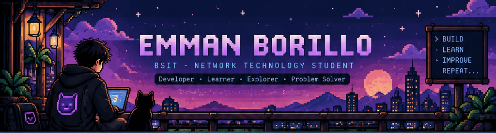
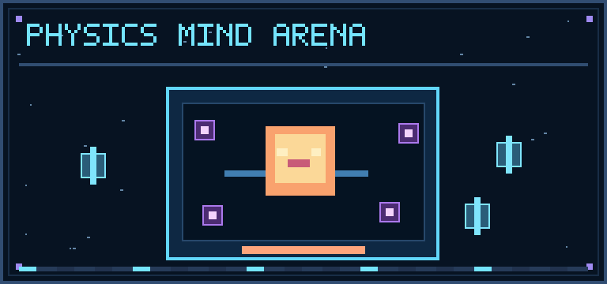
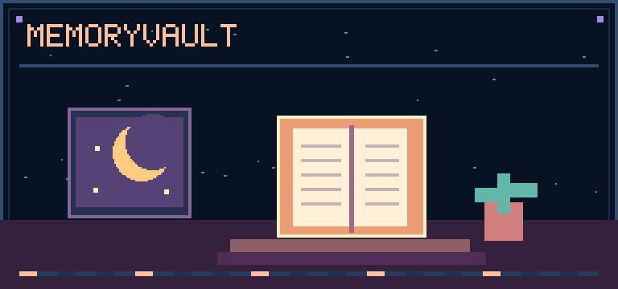
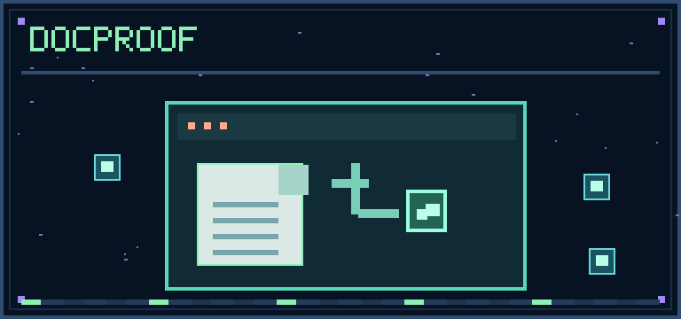
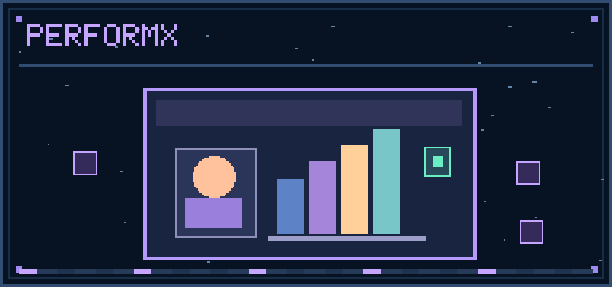

<!-- GitHub profile README for Emman Borillo. Keep the pixel-art PNG files beside this README.md. -->

<code>BSIT • NETWORK TECHNOLOGY</code>   <code>PHILIPPINES</code>   <code>CURRENTLY STUDYING CCNA</code>

<a href="#-about-me">ABOUT</a>  • 
<a href="#-my-toolbox">SKILLS</a>  • 
<a href="#-featured-projects">PROJECTS</a>  • 
<a href="#-github-activity">GITHUB</a>  • 
<a href="#-say-hello">CONTACT</a>

👾 About me
Hey, I'm Emman, an IT student who likes turning ideas into projects you can actually use. I enjoy the creative side of designing interfaces as much as the problem-solving that happens behind the code.

I'm studying Network Technology while exploring full-stack web development, network engineering, and cloud technologies. I'm still learning, but I like building things along the way instead of waiting until I know everything.
> CURRENT QUESTS
  [01] Build useful web apps with React, JavaScript & Firebase
  [02] Strengthen my CCNA and networking fundamentals
  [03] Explore backend systems and cloud engineering
  [04] Collaborate, experiment, debug, repeat

🛠️ My toolbox
Languages & web fundamentals

Frontend & UI design

Data, backend & dev tools

Networking lab: CCNA TCP/IP Subnetting Routing & Switching Troubleshooting

🕹️ Featured projects
<table>
  <tr>
    <td width="50%" valign="top">
      
      <h3>🎮 Physics Mind Arena</h3>
      
Physics study meets arcade-style learning: lessons, flashcards, quiz battles, and achievements.

      
<code>React</code> <code>JavaScript</code> <code>CSS</code>

      <a href="https://github.com/Emman-21/PhysicsMindArena"><strong>Explore the code ↗</strong></a>
    </td>
    <td width="50%" valign="top">
      
      <h3>📔 MemoryVault</h3>
      
A personal digital diary for capturing everyday thoughts, tracking moods, and keeping entries in the browser.

      
<code>JavaScript</code> <code>HTML</code> <code>CSS</code>

      <a href="https://emman-21.github.io/MemoryVault/"><strong>Live site ↗</strong></a> &nbsp;·&nbsp;
      <a href="https://github.com/Emman-21/MemoryVault">Source code ↗</a>
    </td>
  </tr>
  <tr>
    <td width="50%" valign="top">
      
      <h3>🔎 DocProof</h3>
      
A hackathon project exploring how documentation claims can be checked against actual repository evidence.

      
<code>React</code> <code>TypeScript</code> <code>Python</code>

      <a href="https://github.com/Emman-21/docproof"><strong>Explore the code ↗</strong></a>
    </td>
    <td width="50%" valign="top">
      
      <h3>📊 PerformX</h3>
      
A UI/UX concept for managing employee goals, performance reviews, and progress reports.

      
<code>Figma</code> <code>UI/UX</code> <code>Prototyping</code>

      <a href="https://www.figma.com/design/wg2wEIuwKiUIy9chS3io0o/Employee-Performance-Tracker"><strong>View Figma design ↗</strong></a>
    </td>
  </tr>
</table>

🧪 Currently in development
- BlockSync — a class and section management system for schedules, announcements, and student information.
- CTRL+PATH — a BSIT track exploration platform covering Networking Technology, Business Analytics, and System Management.
These projects are still evolving. The features and designs may change as I work on them.

📈 GitHub activity

  
  

Statistics are provided by a third-party service and may not always be available.

✉️ Say hello
If you're working on something interesting or have a project you think I'd enjoy, feel free to reach out. I'm open to collaborations, freelance opportunities, and learning with other developers.

Email me  ·  Connect on LinkedIn  ·  See my GitHub

Made with curiosity, a lot of practice, and probably a few debugging sessions.

